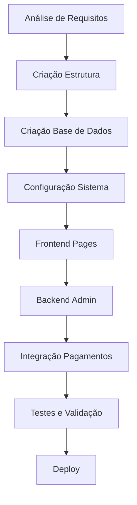

# Plano de Desenvolvimento - Vincit E-commerce de Roupa

## Visão Geral
Projeto de e-commerce de roupa com gestão completa de produtos, utilizadores e encomendas.

## Estrutura de Diretórios
```
vincit/
├── site/
│   ├── admin/
│   │   ├── categorias/
│   │   ├── dashboard/
│   │   ├── encomendas/
│   │   ├── produtos/
│   │   └── utilizadores/
│   ├── loja/
│   │   ├── homem/
│   │   └── mulher/
│   ├── assets/
│   │   ├── css/
│   │   ├── js/
│   │   └── images/
│   ├── includes/
│   │   ├── header.php
│   │   ├── footer.php
│   │   ├── functions.php
│   │   └── config.php
│   ├── pages/
│   │   ├── home.php
│   │   ├── shop.php
│   │   ├── product.php
│   │   ├── cart.php
│   │   ├── checkout.php
│   │   ├── login.php
│   │   ├── register.php
│   │   ├── account.php
│   │   ├── about.php
│   │   └── support.php
│   ├── config.php
│   ├── database.sql
│   └── .htaccess
├── docs/
│   ├── README.md
│   └── CHANGELOG.md
└── tests/
    └── unit/
```

## Base de Dados
- Nome: `vincit_db`
- Tabelas principais:
  - `users` - Utilizadores
  - `products` - Produtos
  - `categories` - Categorias
  - `orders` - Encomendas
  - `order_items` - Itens das encomendas
  - `cart` - Carrinho de compras

## Funcionalidades Principais

### Frontend
- Loja online responsiva
- Sistema de busca e filtros
- Carrinho de compras
- Checkout com Stripe
- Gestão de conta de utilizador
- Páginas institucionais

### Backend (Admin)
- Gestão de produtos
- Gestão de categorias
- Gestão de encomendas
- Gestão de utilizadores
- Dashboard com estatísticas

## Tecnologias
- Backend: PHP 8.x
- Base de Dados: MySQL
- Frontend: HTML5, CSS3, JavaScript
- Pagamentos: Stripe
- Responsivo: Mobile-first

## Fluxo de Desenvolvimento



## Cronograma de Implementação

### Fase 1: Base (Dias 1-2)
- [x] Estrutura de diretórios
- [x] Análise de requisitos
- [ ] Criação ficheiro SQL
- [ ] Configuração base

### Fase 2: Frontend (Dias 3-4)
- [ ] Páginas principais
- [ ] Sistema de produtos
- [ ] Carrinho e checkout
- [ ] Conta de utilizador

### Fase 3: Backend (Dias 5-6)
- [ ] Painel de administração
- [ ] Gestão de produtos
- [ ] Gestão de encomendas
- [ ] Dashboard

### Fase 4: Finalização (Dias 7-8)
- [ ] Integração Stripe
- [ ] Páginas institucionais
- [ ] CSS e JavaScript
- [ ] SEO e otimização

## Próximos Passos

1. Criar ficheiro SQL da base de dados
2. Configurar ficheiros PHP principais
3. Implementar páginas frontend
4. Desenvolver painel admin
5. Integrar sistema de pagamentos
6. Testar e otimizar

---
*Plano atualizado em: 2026-03-27T22:47:56.419Z*